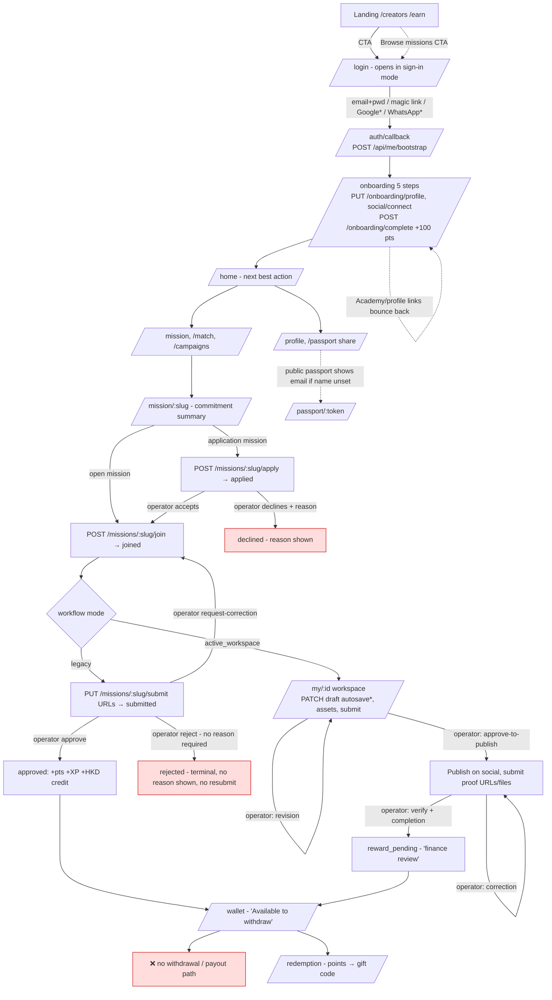
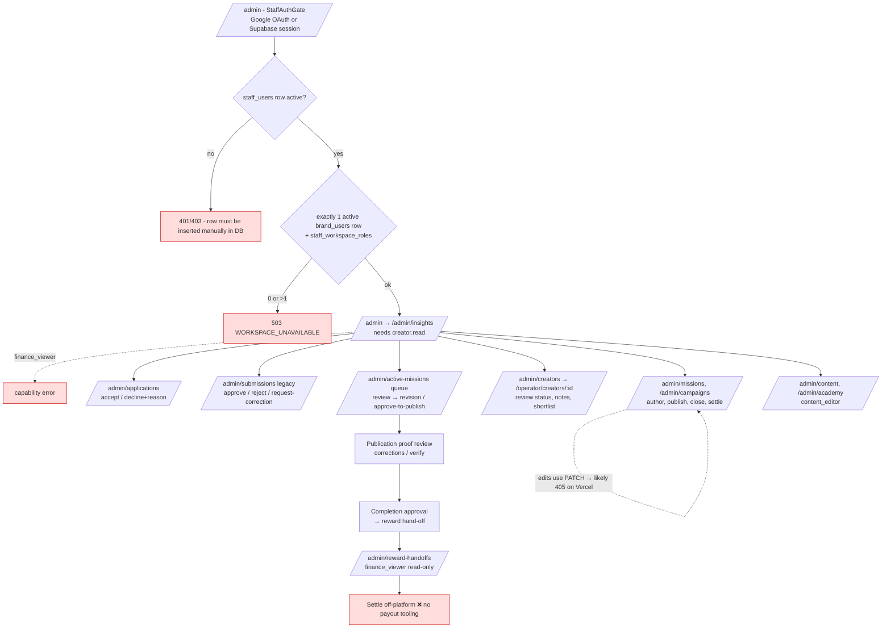

# 01 — Journeys

Commit reviewed: `15f8ed1`. Status legend: ✅ exists and works by code reading · ⚠️ exists with defects · ❌ missing / dead end · ❓ unverified (needs runtime or production check).
Finding IDs (F-xx) are defined in `02-findings.md`.

The product has two creator mission flows, and both appear throughout:
- **Legacy flow.** Every mission uses it unless switched over. It runs on `mission_submissions.status`. The creator submits URLs, and an operator approves (which credits points, XP and cash immediately) or rejects.
- **Active workspace flow.** It is enabled per mission with `creator_workflow_mode = active_workspace`. The creator drafts, then the work goes through review, revision, approve-to-publish, publication proof and completion, ending in a reward hand-off to finance.

---

## 1. Creator journey


`*` Google and WhatsApp sign-in are off by default behind feature flags. The draft-autosave PATCH is likely to return 405 on Vercel (F-001).

### 1.1 Creator step table

| # | Stage / step | Page / API | Data written | Expected result | Status | Findings |
|---|---|---|---|---|---|---|
| C1.1 | Discover product | `/`, `/creators`, `/earn` (`src/routes/_site.*`) | – | Understand value, start signup | ⚠️ "Browse missions" CTA forces login. `/earn` promises withdrawable cash. | F-019, F-006 |
| C1.2 | Sign up | `/login` (`_app.login.tsx:307-350`), Supabase `signUp` | `auth.users` | Account created | ⚠️ Signup CTA opens in sign-in mode. No terms or privacy acceptance. 8-character password minimum is enforced on the client only. | F-008, F-030 |
| C1.3 | Verify email | Supabase confirmations | – | Verified email | ❌/❓ Code assumes confirmations are off (`_app.login.tsx:262-265`). If turned on, the user sees the wrong message. | F-030 |
| C1.4 | Callback and bootstrap | `/auth/callback` → `POST /api/me/bootstrap` (`server/routes/me.ts:45-110`) | `creators`, `point_balances`, `earnings_balances` | One creator row with two balance rows | ⚠️ Upsert errors are ignored and the three writes are not in one transaction. `display_name` defaults to the email or phone. | F-021, F-002 |
| C1.5 | Password reset | `/auth/reset-password` | `auth.users` | New password | ✅ (needs SMTP and redirect allow-list: runbook items 1 and 8 still 🔴) | F-036 |
| C2.1 | Onboarding: primer and interests | `/onboarding`, `PUT /onboarding/profile` | `creators.categories`, `onboarding_step` | Saved, resumable | ✅ Server-persisted resume. Field lengths unbounded. | F-028 |
| C2.2 | Onboarding: social handles | `POST /onboarding/social/connect` | `creators.social_handles` (self-reported) | Handles saved | ⚠️ Collects TikTok, YouTube and 小紅書, but only Instagram and Threads can be verified. | F-024 |
| C2.3 | Onboarding: recommendations and completion | `/onboarding/recommended-missions`, `POST /onboarding/complete` | +100 points (`award_welcome_bonus`) | Welcome points, then home | ⚠️ In-flow links to Academy or profile bounce back to onboarding. Logout is unavailable during onboarding. | F-018 |
| C2.4 | Profile and avatar | `/profile`, `PUT /me/profile`, `/me/profile-media/*` | `creators`, `creator-avatars` bucket | Profile saved | ⚠️ Editing a handle resets its verified flag. No client-side size check on avatar. | F-024 |
| C2.5 | Verify social ownership | `/social/accounts/*` (bio code plus RapidAPI scan) | `creator_social_accounts` | Verified badge | ✅ Instagram and Threads only | F-024 |
| C2.6 | Payout details / KYC / tax | – | – | Creator can be paid | ❌ Does not exist | F-006 |
| C3.1 | Find a mission | `/mission`, `/match` (LLM), `/campaigns` | – | Relevant missions | ⚠️ Campaign detail spins forever on error. `/match` calls the LLM with no rate limit. | F-026, F-023 |
| C3.2 | Commit (join or apply) | `/mission/:slug` → `POST …/join` or `…/apply` | `mission_submissions` (+10 XP on join) | Joined or applied | ✅ Commitment summary and classified gate errors. Mutation rejections are uncaught (`_app.mission.$missionSlug.tsx:117-119`). | F-040 |
| C3.3 | Create content: legacy | `PUT /missions/:slug/submit` (URLs) | `submission_data`, status `submitted`, +25 XP | Submitted | ⚠️ Textarea has no label. Error text mixes both languages in one string. `submission_data` is unbounded. | F-028, F-033 |
| C3.4 | Create content: active (draft, assets, versions) | `/my/:id`, `PATCH …/work-items/:wid/draft`, upload-grant/finalize, `POST …/submit` | drafts, versions, assets (private bucket) | Autosaved draft, versioned submit | ⚠️/❓ Well designed (revision conflicts, idempotency), but the autosave PATCH likely returns 405 in production. | **F-001** |
| C4.1 | Submission feedback | `/my`, `/my/:id`, notifications | – | Clear current status | ⚠️ Two "Under Review" groups on `/my`, `expired` filed under Rejected. The active workspace link is lost after `joined`. | F-025, F-031 |
| C4.2 | Notifications | `/notifications` (in-app; unread count polled every 60 s) | `read_at` | Alerted on each change | ⚠️ In-app only, no email or push. Correction request and deadline reminders are never sent. | F-012, F-013 |
| C5.1 | Outcome: approved | trigger `submission_approved` | points, XP, `earnings_transactions` | Reward visible | ✅ legacy | – |
| C5.2 | Outcome: rejected | trigger `submission_rejected` | status `rejected` | Reason plus a path to fix | ❌ Reason not shown, no resubmit. Notification says "needs work". | **F-010** |
| C5.3 | Outcome: revisions requested | legacy: `request-correction` → `joined`; active: `revision_requested` | notes, revision grant | Creator knows what to change | ⚠️ Legacy: unlabelled note with no notification. Active: per-item required changes and deadline ✅, but the deadline is shown in UTC. | F-012, F-020 |
| C6.1 | Publish and proof (active) | `ProofSubmissionForm`, `POST …/publication/:wid/proofs` | proof attempts, assets | Proof verified | ⚠️ Form is English-only. Sticky submit sits under BottomNav on mobile. The server fetches the URLs (SSRF hardened). | F-027, F-042 |
| C6.2 | Campaign matching and leaderboard | `/campaigns/:slug`, leaderboard | `campaign_participants` (trigger) | Rank and prize | ⚠️ Raw ISO end date. Prize points bypass the budget. | F-026, F-039 |
| C7.1 | Earnings view | `/wallet` | – | Accurate balance and pending | ⚠️ Shows HK$0.00 while loading or on error. Pending excludes active-mission rewards. Dates are UTC slices. | F-020, F-029 |
| C7.2 | Get paid | – | – | Cash to bank or FPS | ❌ No payout. Active-mission `reward_pending` is never settled into any ledger. | **F-006, F-007** |
| C7.3 | Redeem points | `/redemption`, `POST /redemption/redeem` | `redemptions`, `redemption_codes`, points debit | Gift code | ✅ The intent path is idempotent. The legacy path is not. Physical gifts can't be redeemed without a code pool. | F-041 |
| C7.4 | Analytics and performance | `/passport` scores, level/XP | – | Performance insight | ⚠️ No per-content metrics | F-044 |
| C8.1 | Support and disputes | `/contact` | – | Reach a human | ❌ The contact form does not send. The reward-pending "contact support" link is a dead end. | F-011 |
| C8.2 | Delete account / export data / change email | – | – | GDPR/PDPO-style rights | ❌ Missing, and deletion is structurally blocked by the database | **F-009** |
| C8.3 | Logout | `/profile` only | – | Sign out anywhere | ⚠️ Not in navigation or onboarding | F-018 |

---

## 2. Operator journey



### 2.1 Operator step table

| # | Stage / step | Page / API | Data written | Expected result | Status | Findings |
|---|---|---|---|---|---|---|
| O1.1 | Sign in | `StaffAuthGate` (`src/components/admin/StaffAuthGate.tsx:62-66`), `GET /api/admin/me` | `staff_users` (auto-promotion intended) | Staff session | ⚠️ Auto-promotion is dead (`server/routes/admin.ts:54` passes `emailVerified=false`). Deep links are dropped (`next=/admin`). | F-015, F-034 |
| O1.2 | Role assignment | `PUT /api/admin/staff-access/:userId` (API only) | `staff_workspace_roles`, `staff_access_audit` | Admin grants a role in UI | ❌ No UI. Manual DB or curl. | F-015 |
| O1.3 | MFA / session | Supabase session, `onAuthStateChange` | – | MFA for privileged staff; expiry handled | ⚠️ No MFA. Expiry is handled on queries but not on mutations. | F-035 |
| O2.1 | Dashboard | `/admin` → `/admin/insights`, sidebar badges | – | Queues, KPIs, alerts at a glance | ⚠️ Lands on an error for finance/content roles. Badges only for applications and submissions, counted with `.length`. No SLA or stuck-item alerts. | F-016, F-013, F-046 |
| O3.1 | Applications | `/admin/applications`, `POST …/accept\|decline` | `mission_submissions`, `operator_audit_events` | Decide with reason and audit | ✅ Idempotent, first decision wins, decline needs a reason | – |
| O3.2 | Legacy submissions | `/admin/submissions`, `POST …/approve\|reject\|request-correction` | status, points, XP, cash, budget debit | Decide with reason, audit and confirm | ⚠️ Reject needs no reason or confirmation. Approve and reject record no operator or audit. Deep link shows actions on already-decided items. | **F-004**, F-037 |
| O3.3 | Active-mission review | `/admin/active-missions/:wf` (`start-review`, `request-revision`, `approve-to-publish`) | review rounds, workflow events | Concurrency-safe decisions | ✅ `expectedRevision`, idempotency keys, required reasons | – |
| O3.4 | Publication proof review | proof-review start / corrections / verify, metadata-refresh | proof reviews (append-only) | Verified proof | ✅ | – |
| O3.5 | Completion and reward contract | `POST …/completion`, `…/reward-contract` | `mission_completion_decisions`, `mission_pending_rewards` | Reward handed to finance | ⚠️ Accepted applications have no reward contract, so completion is blocked until a manual backfill. | F-038 |
| O3.6 | Bulk actions | – | – | Approve or reject many at once | ❌ None | F-045 |
| O3.7 | Audit trail visible | creator detail page only | – | Audit per item | ⚠️ Partial | F-004 |
| O4.1 | Creator list and search | `/admin/creators` (server page of 25) | – | Find a creator | ✅ | – |
| O4.2 | Creator review, notes, shortlist | `/operator/creators/:id`, `/operator/missions/:id` | CRM tables, audit | Notes and flags | ⚠️ Re-shortlisting resets status. Shortlist audit write is outside the transaction. | F-043 |
| O4.3 | Suspend / reinstate / impersonate | – | `creators.status` exists but is unused | Account control | ❌ Missing | F-017 |
| O5.1 | Mission authoring | `/admin/missions/*` (POST, **PATCH**, publish, close, duplicate) | `missions` | Safe edits | ⚠️/❓ PATCH likely returns 405 on Vercel. No optimistic lock. Publish is check-then-update. No CHECK constraints on rewards. | **F-001**, F-022, F-003 |
| O5.2 | Campaign authoring and settlement | `/admin/campaigns/*` | `campaigns`, ledgers on settle | Safe edits and settle | ⚠️ Same PATCH and locking issues. Duplicate "campaign started" notifications on double publish. | F-001, F-022 |
| O5.3 | Budget / inventory | `credit_workspace_budget` (RPC only), `/admin/gifts/:id/codes` (API only) | budgets, codes | Fund missions, stock gifts | ❌ No budget API or UI. Gift codes are API-only with a read-modify-write race on stock. | F-039, F-041 |
| O6.1 | Reward hand-off queue | `/admin/reward-handoffs` (cursor paging) | settings, notification retry | Finance sees what to pay | ✅ Read-only | – |
| O6.2 | Payouts / refunds / invoices / reconciliation / exports | – | – | Run finance in-product | ❌ None. Legacy cash credits never appear in the hand-off queue. | **F-006**, F-007 |
| O7.1 | Configuration and flags | reward window setting, env flags | `workspaces` | Configure without deploy | ⚠️ Minimal | F-045 |
| O7.2 | CMS / Academy | `/admin/content`, `/admin/academy` (content_editor) | content, lessons | Publish learning content | ⚠️ Edits use PATCH (F-001). Media upload has no type or size checks and goes to a public bucket. | F-001, F-014 |
| O8.1 | Monitoring and failed jobs | cron response bodies only, 13× `console.error` | – | Alerts, failed-job view | ❌ No error tracking, alerting or failed-job view | F-032 |
| O8.2 | Reports / exports | `/admin/insights`, `/admin/radar`, `/admin/engaged` | – | CSV export, HKT cut-offs | ⚠️ No exports. Insights shows financials to the reviewer role. Lists are unpaginated. | F-046, F-016 |

---

## 3. Brand journey (secondary)

| # | Step | Page / API | Status | Findings |
|---|---|---|---|---|
| B1 | Invited by staff | `POST /api/admin/brand-invites` (API only) | ⚠️ No UI. Token stored in plaintext. | F-015 |
| B2 | Log in and accept | `/brand/login` magic link → `POST /api/brand/accept` | ⚠️ Doesn't check `email_confirmed_at` | F-034 |
| B3 | Author, publish, close missions | `/brand/missions/*` (RLS client) | ⚠️ Can publish cash missions with no staff gate or funding. Direct PostgREST INSERT bypasses validation. | **F-003** |
| B4 | See results / spend | – | ❌ Brands cannot see applicants, submissions or spend | F-045 |
| B5 | Session / logout | `BrandAuthGate`, `BrandNav` | ⚠️ No logout in nav. Expiry handling is a no-op. | F-035 |

---

## 4. Handoffs between creator and operator (highest risk)

```mermaid
sequenceDiagram
  participant C as Creator
  participant DB as Supabase (RPC/trigger)
  participant N as notifications (in-app)
  participant O as Operator
  participant F as Finance (off-platform)
  C->>DB: apply_mission → applied
  Note over O: no operator notification; sidebar badge (polling, unbounded .length)
  O->>DB: decide_mission_application (idempotent)
  DB->>N: application_accepted / declined (trigger)
  C->>DB: submit_mission → submitted (+25 XP)
  Note over O: no alert; 48h review_deadline not enforced
  O->>DB: approve_submission (points+XP+cash+budget, one tx; no operator recorded)
  DB->>N: submission_approved
  O->>DB: reject_submission (no reason needed)
  DB->>N: submission_rejected ("needs work" but terminal)
  O->>DB: request_legacy_evidence_correction → joined
  Note over N: ❌ no notification for this transition
  O->>DB: active: request-revision / approve-to-publish / proof verify
  DB->>N: mission_* notifications (best-effort; failure doesn't roll back)
  Note over N: ❌ deadline_approaching/overdue never emitted (cron doesn't call it)
  O->>DB: approve_mission_completion → reward_pending
  DB->>N: mission_reward_pending
  O-->>F: hand-off queue (read-only)
  F-->>C: ❌ no in-product payout / settlement / status back to creator
```

| Handoff | Direction | Status sync | Notification | Race / concurrency | Permission boundary | Orphan / mid-step failure | Findings |
|---|---|---|---|---|---|---|---|
| H1 Application → decision | C→O→C | ✅ RPC | O: ❌ none (badge only). C: ✅ | ✅ First decision wins (409 `APPLICATION_DECIDED`) | ✅ `application.review` | Accepting an active-workspace application creates no reward contract, so completion is blocked later | F-013, F-038 |
| H2 Legacy submit → review | C→O | ✅ | O: ❌ none. No SLA enforcement. | ⚠️ Two operators: state check plus `FOR UPDATE` stops a double credit, but reject vs approve is a silent race with no revision check | ✅ `submission.review` | Approval credit has no unique ledger reference. Idempotency relies on status only. | F-004, F-013 |
| H3 Legacy decision → creator | O→C | ✅ | approve ✅ · reject ⚠️ (misleading) · correction ❌ | – | – | Rejection is terminal with no resubmit, which dead-ends the creator | F-010, F-012 |
| H4 Active draft submit → review | C→O | ✅ expected-revision RPCs | O: ❌ no badge for the active queue | ✅ revision conflict (409) and idempotency | ✅ | ✅ Notification failure doesn't roll back | F-013 |
| H5 Review → revision → resubmit | O→C→O | ✅ | C: ✅ revision requested. Deadline reminders ❌. | ✅ | ✅ | Revision deadline shown in UTC, so it looks 8 h early in HKT | F-012, F-020 |
| H6 Approve-to-publish → proof → verify | O→C→O | ✅ | ✅ | ✅ | ✅ `proof.review` | Proof form is English-only and partly hidden on mobile | F-027 |
| H7 Completion → finance → creator | O→F→C | ⚠️ ends at `reward_pending` | C: ✅ pending, then ❌ nothing further | ✅ one pending per workflow | `finance_viewer` read-only | ❌ No settled state, no ledger credit, wallet doesn't show it. Support link is a dead end. | F-006, F-007, F-011 |
| H8 Brand publishes mission → creators | B→C | ✅ | `campaign_started` broadcast (campaigns only) | ⚠️ Double publish → duplicate broadcast | ⚠️ No staff approval gate. Direct INSERT bypass. | Unfunded cash missions, then `insufficient_budget` at approval with no fix path | F-003, F-022, F-039 |
| H9 Session expiry mid-action | both | – | – | Creator: `_app.tsx:40-44` signs out on 401. Operator: queries ✅, mutations ⚠️. Brand: ❌ | – | Draft autosave keeps local state on conflict ✅ | F-035 |
