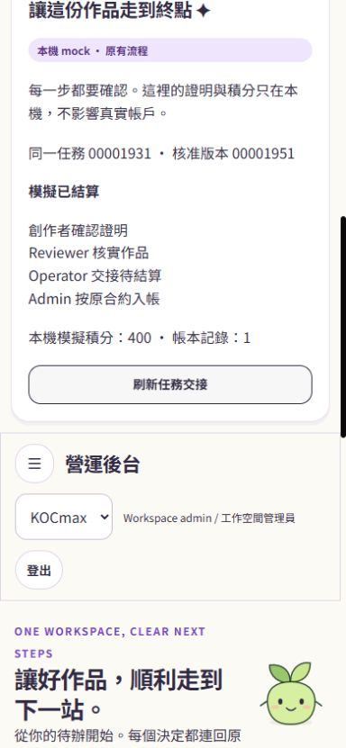
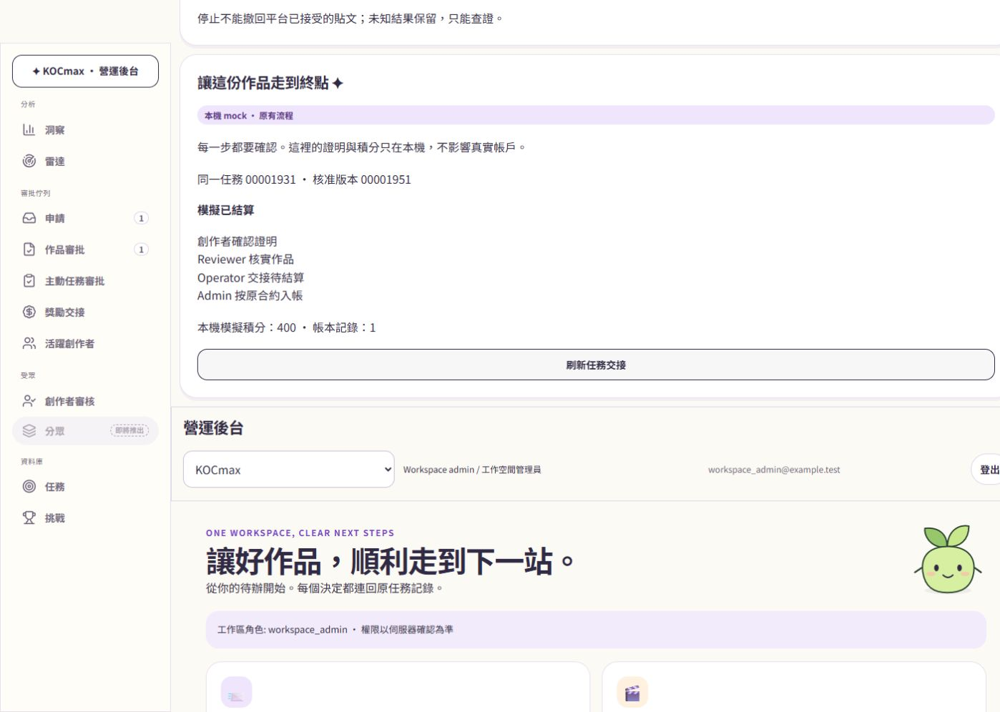

# Persistent local mock acceptance — 2026-11-06

## Outcome

The Vite fixture now uses an on-disk PGlite database and the existing publish repository, with the original mission approval/proof/review/completion/reward SQL loaded locally. Same submission `00001931`, approved version `00001951`: creator confirms mock publication, explicitly submits proof, reviewer verifies, operator creates pending reward, and admin settles the frozen contract exactly once. Local result: 400 points, one ledger entry. No remote database, real Auth, provider or reward transaction occurred.

## Direct browser evidence

In-app browser, loopback port8796. Creator preview includes final JPEG, caption, account, disclosure and instruction revision. Explicit publication produced request suffix `d6e82b41`; proof and review were completed at390px, completion and settlement at1440px. The desktop sidebar initially obscured the mock confirmation checkbox; the DEV-only staff wrapper now reserves sidebar space and uses Studio theme variables. The corrected control was clicked successfully.

Stopped and restarted the Vite process using the same database, then reloaded: same request, one mock publication, 400 local points, one ledger record, zero real proof/reward effects. Creator return also retained the result. Brand member sees no journey controls. Five viewport checks:320/390/430/1024/1440; document widths314/384/424/1018/1434, no horizontal overflow. This is one journey spanning mobile and desktop, not two independent publications.

## Automated evidence

- Growth/publishing scoped regression:46 files,837 passed (`persistent-regressions.log`).
- Original mission/reward regression:19 files,486 passed,46 intentionally skipped live/environment tests (`original-workflow-regressions.log`).
- Restart suite:7 passed, including initialization interruption, reservation/enqueue crash repair, unknown preservation and known-media recovery (`restart-regressions.log`).
- Final abandoned-job/service tests:12 passed (`abandoned-recovery.log`).
- UI and opt-in production bundle boundary:9 passed (`final-ui-boundary.log`).
- Default-off build and TypeScript passed; production marker scan zero. Opt-in build passed and boundary scan passed. ESLint:0 errors,2 existing ref-cleanup warnings.
- These suites overlap; counts are not a unique grand total. No whole-repository PASS claim.

Logs: `.superpowers/sdd/2026-11-06-kocmax-controlled-instagram-pilot/`.

## Review and recovery rules

Independent reviewer Dirac found four Important defects, then one recovery follow-up. All were corrected; final scoped read-only review reports no outstanding Critical/Important findings.

- Reopening repairs missing jobs for already reserved intents without publishing. A fresh explicit preview/consent resumes a queued intent.
- Status/reconcile claims only known-media recovery. It cannot create containers or publish.
- Expired ambiguous checkpoints become outcome_unknown; active leases remain untouched.
- Known-media recovery records a target-bound late receipt through the original repository before the guarded final transition.
- Local initialization is one transaction. Only standalone migration transaction wrappers are removed in the local fixture loader. Interruption rolls back and reopening succeeds.
- Canonical owner serialization prevents JSONB key ordering from changing approved-content fingerprints.

## Fidelity and remaining boundaries

Auth users/claims and Storage are inert local fixtures. Vector types/search/indexes are replaced only to load the original schema in PGlite; mission/proof/reward command bodies are preserved. This does not prove hosted Auth/RLS, Storage, vector search or Meta behavior.

The fixture starts at an immutable submitted version, then invokes original review/approval. A pre-existing ready-asset attachment guard raised `immutable_record` when exercising original draft submission; it was not weakened or bypassed in production SQL. Upload/finalization-to-submit is therefore not accepted by this pilot test. The requested already-approved-work path is covered.

The new journey card reflects durable original SQL. Other historical preview panels continue to use their existing synthetic data; their balance/proof lists are not evidence for this local database. Existing private collection copy/version/provenance behavior is preserved, but automatic pilot receipt-to-collection integration is not implemented. Production authenticated mission/product authority and OAuth composition also remain disabled/incomplete. The whole real-pilot stage is NOT complete; launch packet remains BLOCKED. No request for live approval is made.

## Preservation

Same branch `codex/kocmax-studio-stages-1-2`; no staging or commits. Baseline audit722/727 identical, with the same five intentional existing-file edits recorded in `persistent-preservation-check.json`. Existing migrations unchanged. Local preview database and test evidence retained; no destructive cleanup, deployment, remote SQL or real connections.
