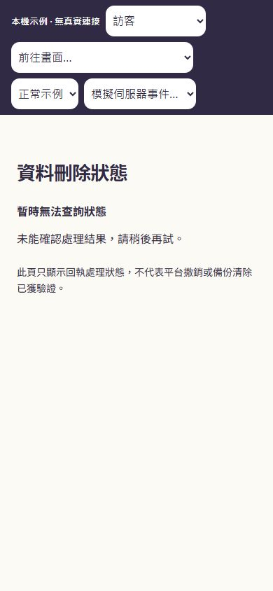
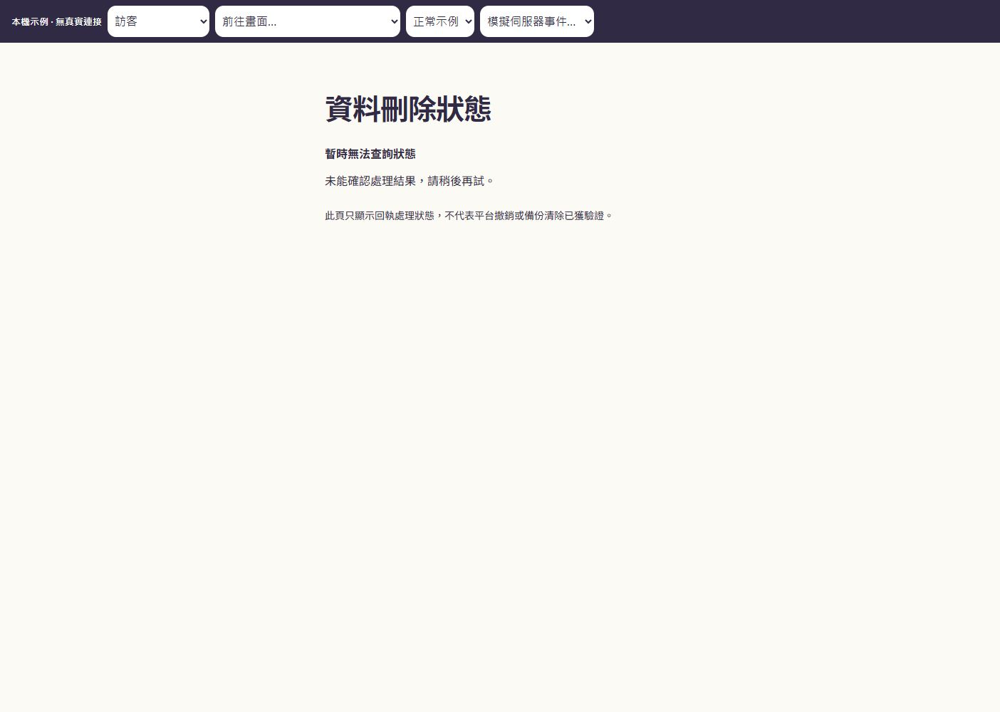

# D1 本機準備檢查點（歷史：2026-10-31）

> **目前狀態（2026-11-03）：** 下文保留當日的本機準備結果及當時「尚未批准／未執行」的紀錄，不能作為現在的執行狀態。之後使用者批准並已套用 SQL、完成九帳戶 API／RLS 與手機／桌面實測，以及精確測試資料清理。請先讀 [D1 共用資料庫試點收尾](D1-CLOSEOUT-20261103.md)及其原始回執。原方案的獨立環境與真實 provider 驗證仍未完成。

日期：2026-10-31 HKT。分支：`codex/kocmax-studio-stages-1-2`；D0 基線：`5c60020091e8e6fee934b61c498bf7518944c433`。

**D1 未完成。現有資料庫寫入未獲批准。** 使用者最新要求先評估直接使用現有 Remix-Adfocate 的影響；詳見 [影響評估](existing-database-impact.md)。沒有建立分支、部署、套用 SQL、建立測試帳號或真實平台連接。原 D1 的隔離條件不能由本機測試取代。

## 已保留的本機準備

- 目標與參與者核對：批准紀錄必須與獨立觀測相符，過期或不一致時拒絕；已知產品資源仍被排除。
- 獨立的試點入口及封裝檢查：預設沒有可執行的實際環境組合；關閉排程和自動 Git 部署；只允許已審閱的方法／路徑到達注入的處理器。真實郵件、模型、社交、兌換及未列出的操作被拒絕。
- 只用注入示例的通知／回執路徑、OAuth 來源核對，以及公開的最小刪除狀態頁。實際回執資料庫讀取器及平台身分映射尚未接上。
- 回執頁使用獨立入口，避免一般登入初始化與行銷／帳號導覽；頁面實際產生禁止索引與不傳送來源網址的設定。正式 hosting 的標頭仍未驗證。

## 本輪證據

| 檢查 | 結果與界線 |
| --- | --- |
| 修正後選定回歸測試 | 23 個檔案、312 個測試通過；含試點限制、通知／OAuth、原有管理操作、登入快取、行銷入口及回執頁。不是全套測試或遠端驗收 |
| Task 3 凍結子集 | 5 個檔案、113 個測試通過；包含於上述回歸範圍，不可相加重複計數 |
| Task 2 凍結子集 | 22 個測試通過；包含於上述回歸範圍，不可相加重複計數 |
| 靜態檢查 | 修正後 TypeScript、範圍內 ESLint、ESM 與 diff 格式檢查通過 |
| 本機正式模式建置 | 修正凍結後 `npm run build` 通過，包含 ESM、路由產生、TypeScript 與 Vite；沒有部署。既有 `_site.smoke.test.tsx` 路由命名警告仍在 |
| 獨立覆核 | Task 1 本機範圍獲接納；Task 2／3 的四個 P2 修正再審通過。僅覆核本機準備，不批准共用資料庫寫入或遠端就緒 |
| 內建瀏覽器手機 | 390 × 844；回執頁無水平溢出，實際頁面有 `noindex, nofollow`、`no-referrer`，沒有帳號連結 |
| 內建瀏覽器桌面 | 1440 × 1000；相同檢查通過 |
| 狀態誠實性 | 未接查詢服務顯示「暫時無法查詢狀態」，沒有宣稱刪除完成或平台已撤銷 |
| 既有資料庫／release 基礎 | 本輪沒有改動 Supabase migrations、release 工具或依賴 lockfile；沒有執行遠端寫入 |

測試使用本機示例控制列；它不代表真實帳號或已獲平台授權。瀏覽器只驗證這次新增頁面，未把上一階段旅程截圖算作本輪重新驗收。原有行銷測試替身的 `activeProps` 警告保留；沒有因警告而宣稱測試失敗或修正無關功能。

## 仍未驗證

實際 Auth／JWT／RLS、兩條獨立資料庫連線、現有資料庫最小更新清單、持久憑證及權限撤銷、公開 callback 與 hosting 保護、伺服器日誌、實際 worker 資源限制、定時清理、備份與還原、真實 Google／Instagram：均未驗證。Task 4／5 及原定完整 D1 驗收未開始；需要先確定變更後的共用資料庫範圍。

## 手機與桌面畫面

