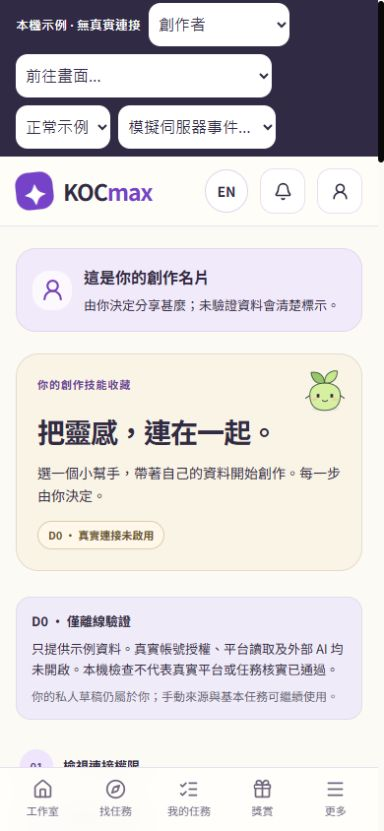
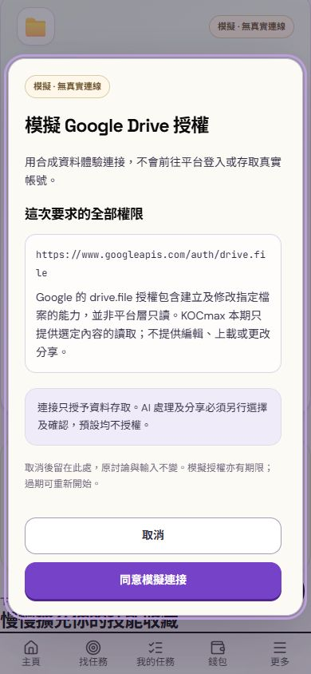
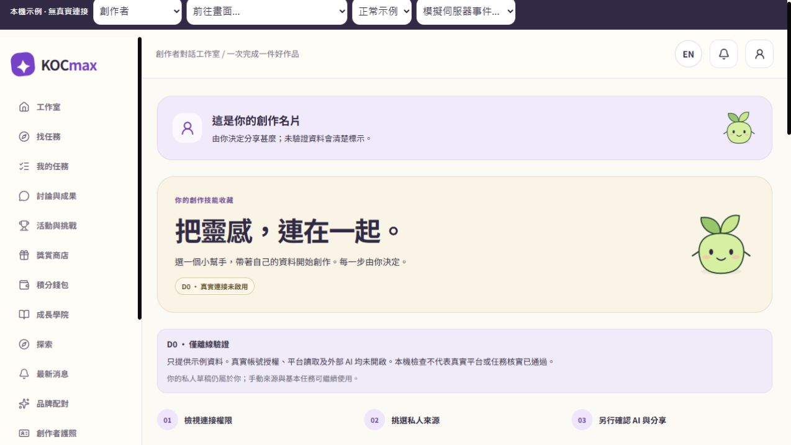
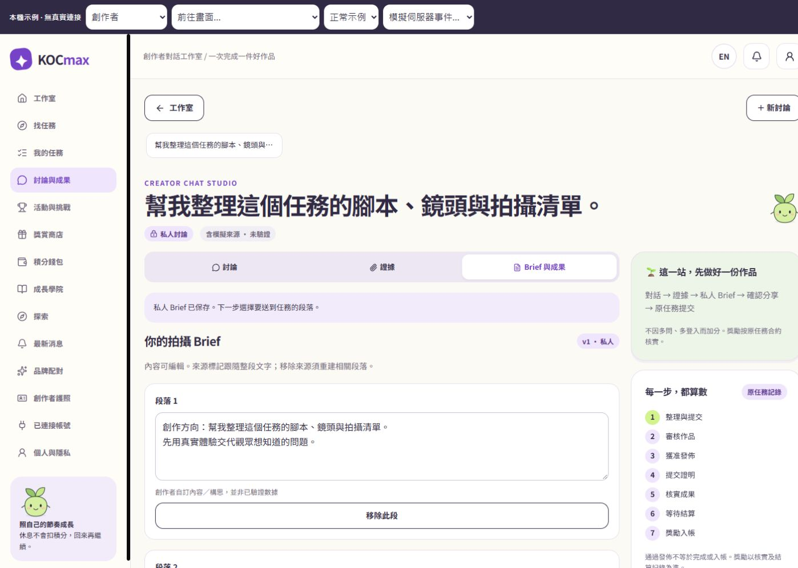

# Stage 4D / D0 離線實作與驗證

日期：2026-10-31 HKT。分支：`codex/kocmax-studio-stages-1-2`。基線：`3fcdda17dee4a349ed791f305d44f5765d7924ff`。

**D0 離線準備已完成。真實 Instagram／Google 授權、平台讀取、遠端資料庫、外部 AI、排程、部署及 production 驗收均未執行。** 沒有 push 或 merge。D1/D2/D3 仍按原計劃分別批准。

## 交付範圍

| 工作 | 本次完成 | 入口／依據 |
| --- | --- | --- |
| W1 版本與執行邊界 | API／scope manifest、精確 target 比對、未知 transport 預設 live 並拒絕進入 D0；旗標不會開啟真實入口 | `provider-manifest.json`、`pilotPolicy.ts`、`pilot-preflight.ts` |
| W2 授權與憑證 | 加密單次 state/code/ticket、Google PKCE/nonce/RS256 驗簽、注入持久 keyring、refresh lease/CAS、撤銷協調、Meta 簽章與明確映射 contract | `oauth.ts`、`oauthStore.ts`、`googleIdentity.ts`、`keyProvider.ts`、`metaNotice.ts`、`integrationOAuth.ts` |
| W3 Instagram | 固定 v26.0、自己的支援媒體、50 筆／5 頁／30 日挑選上限、lifetime 指標、零／缺值分開、部分結果與有界重試 | [provider-capabilities.md](provider-capabilities.md) |
| W4 Drive | 只讀明確選檔、openid 身份驗證、前後 metadata 檢查、Docs/text/PDF、5 檔／5MiB、PDF 隔離 worker、未知權利不升格 | 同上及 `offlineAdapters.ts` |
| W5 私人來源與 Brief | 真實形狀 adapter → 加密 SQL grant → Picker receipt → 私人選檔／匯入完整離線組裝；證據版本／期間；外部模型保持關閉 | `integrations-offline-adapters.test.ts`、`studio-integration-ai-boundary.test.ts` |
| W6 私隱營運 | 新增 migration、service-only RPC、世代檢查、維護 lease／batch／dry-run、tombstone、還原隔離 contract、去秘密匯出 | [persistence.md](persistence.md)、[privacy-runbook.md](privacy-runbook.md) |
| W7 手機／桌面 | D0 說明、擬議權限、未連接／過期／撤銷等待／人工處理／重新授權、Picker 取消與焦點、私人用途預設 | [ui.md](ui.md)、[journeys.csv](journeys.csv)、下方截圖 |
| W8 驗證與交付 | 完整本機回歸、最終受影響案例、建置、lint、manifest、獨立審查與 A01–A17 證據分類 | [acceptance.csv](acceptance.csv) |

正式 app 只加入關閉中的 OAuth／Picker 路徑；沒有組裝 live coordinator，預設回傳 `PILOT_APPROVAL_REQUIRED`。官方 Picker bridge 只有注入介面，D0 在 SDK／token callback 之前拒絕開啟。離線 fixture transport 是受信任測試組裝，不宣稱可隔離任意被注入 JavaScript 的網路能力。

## 保存既有功能與修正

- 原任務、內容審批、發佈證明、凍結獎勵合約、一次性入帳、品牌／營運／財務入口未替換；對話依然接回原流程。
- 三個既有整合 migrations 沒有修改。新增 migration 以原 dispatcher 為基礎擴充；49 個原 SQL 行為案例再跑一次新 schema。
- 4A–4C 的 read permit、來源版本／世代、重新授權清除、穩定文件 ID、撤銷歷史遮蔽及 403 後 cache 不復活均保留回歸。
- 本次增加的修正：舊 Google grant 的 purge/revoke 不影響同帳號的新 grant；refresh 缺少或 malformed lease/CAS 欄位時拒絕；相同內容的新觀測可保留新舊證據；同一 Drive 選檔重試回傳原結果；關閉 Studio 不會把私人歷史誤送一般模型；取消的舊 query 不會干擾 StrictMode 的新請求。
- [獨立審查紀錄](persistence-review.md) 保留原始重現、修正與結案證據。限定審查內沒有尚未處理的發現；這不是全面安全認證或 live 驗收。

## 實際測試結果

環境：Windows、Node **24.18.0**、npm **11.16.0**、Vitest **2.1.9**。`RUN_INTEGRATION=0`、`RUN_AUDIT_INTEGRATION=0`。合成資料、本機 PGlite 及離線 Chromium；沒有使用使用者帳號憑證。

| 檢查 | 結果 | 範圍／限制 |
| --- | --- | --- |
| 完整 `vitest run --maxWorkers=2 --minWorkers=1` | **328 files passed，3,004 tests passed；44 files／363 tests skipped** | 18:18:44 HKT 開始，304.04 秒；略過均屬既有環境條件，未視為通過 |
| 最終 SQL／manifest 受影響重驗 | **6 files，111 tests passed** | 18:24:56 HKT，9.61 秒；包含 16 SQL、8 memory、49 原 SQL、1 完整組裝、37 release checks |
| 原任務與獎勵專項 | **485 passed，46 existing skipped** | 19 files，31.80 秒；同一批測試亦包含在完整 suite，數字不可相加 |
| `npm run build` | **PASS** | ESM、全專案 TypeScript、Vite；不等於 PDF server worker 的目標 host 封裝驗收 |
| 所有新增／變更 TS/TSX/MJS 的 ESLint | **PASS** | 沒有 lint error；不表示修改範圍外所有歷史程式已重新整理 |
| `release:manifest:write` + `release:manifest:check` | **PASS** | 純本機生成及比對，沒有執行 release |
| `git diff --check` | **PASS** | 沒有空白差異錯誤 |
| Integration responsive layout | **30 browser checks passed** | 320／390／430／768／1024／1440px、360px 高度、減少動畫、44px 控件與溢位；包含在完整 suite |
| 內建瀏覽器手動旅程 | **PASS（示例範圍）** | 手機 390×844、桌面 1440×1000；細項見 journeys.csv |

完整 suite 執行期間最後一項 SQL 重試修正完成，因此其後以凍結版本重跑所有上述受影響案例。沒有把較早 manifest 的通過結果當作最終版本證據。

最終 migration SHA-256：`485bee1d9978bced3983a70a846825e410a19805dd47d972739c7ae2c55ebdbc`。

最終 release manifest digest：`947fbfaba4b5990663adfd6644dccca6f63c2c26a6a261c8741f51fcba75abb5`。

本機原始記錄位於 `.superpowers/sdd/2026-10-31-kocmax-stage-4d/logs/`：`full.log/json`、`final-affected.log/json`、`active-missions.log/json`、`build-final.log`、`lint-final.log`。該資料夾依既有規則不提交；這份報告、驗收 CSV 與截圖會隨分支保存。

建置的既有提示仍在：測試 route 不匯出 Route，以及數個 route export 無法 code-split。這些不是本次新增故障。

## 手機與桌面證據

內建瀏覽器先確認外殼關閉時的 mock 連接兼容性，再啟用**本機程序**的四個預覽旗標驗證完整工作室。沒有更改部署環境。已確認首頁首次進入連接頁無需按重試；取消選檔保留問題；私人匯入時 AI／處理／分享未預勾；Brief v1 私人保存；權利未知的來源段落阻止轉存；撤銷後來源摘錄遮蔽；等待撤銷時無法重連；重試解決後重新授權不繼承舊選檔；桌面過期提示／Escape 焦點恢復；D0 的兩個真實連接按鈕均 disabled。

## 真實試點仍需批准及完成的事項

1. **Instagram 撤銷與帳號映射**：v26.0 指標參考已核對；目前 DELETE permissions 只有離線候選契約，尚未取得該 Instagram Login 產品確切的撤銷文件。Meta 通用 app-scoped ID 不可直接等同 Instagram account ID。二者在 live transport 啟用前必須核實。
2. **D1 目標與 runtime 組裝**：指定隔離專案／HTTPS origin／callback、持久 keyring／secret、allowlist、真實 SDK／CSP、provider notice route 與人工可讀刪除狀態頁、PDF worker 封裝及資源上限。這些沒有部署或設定。
3. **D2 真實驗收**：指定測試帳號與 fixtures、普通 JWT/PostgREST/RLS、兩條真 DB 連線的競態、真實 provider revoke／refresh、排程與隔離還原、真 iOS/Android/desktop OAuth／Picker、至少連續八日觀察。PGlite、合成時鐘與桌面 viewport 不替代上述證據。
4. **權利與模型**：Google 的 `drive.file` 包含寫入能力，產品限制只讀不會縮減 token 本身能力；可讀／ownedByMe 不證明處理或轉分享權。未知權利保持私人。外部模型必須另行 D3 批准；來源資料不會因本次離線驗證被送出。

`integrations-live-pilot.test.ts` 僅驗證禁止啟用的入口；不是 live 測試 runner。維護腳本僅 memory dry-run，沒有安裝排程。還原時須隔離整個目標；`restore_pending` 不是所有讀取路徑的全域封鎖。

**A01–A16 的 live 驗收保持 NOT RUN；A17 保持 NOT RUN（D3 未批准）。D0 完成不構成 4D-read-pilot PASS、4D-AI-pilot PASS 或 production release 批准。**
