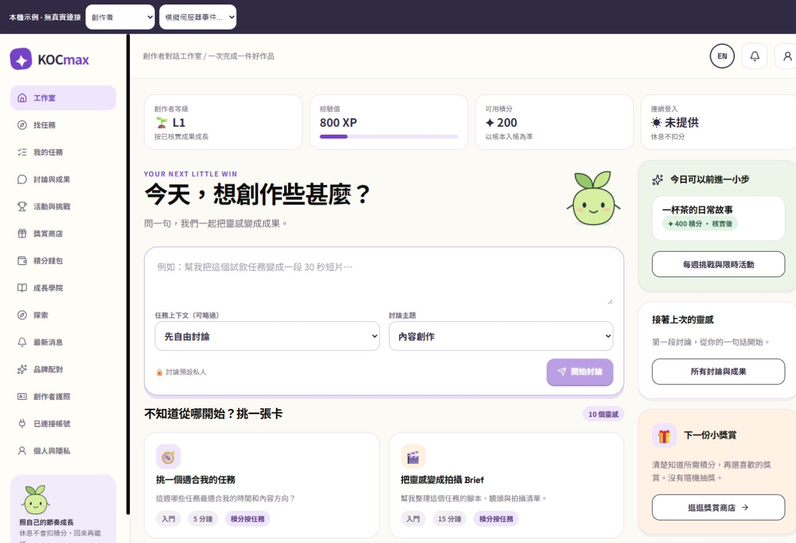
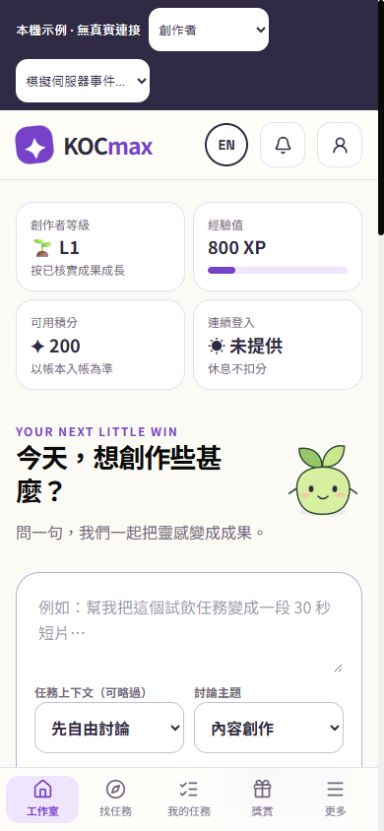
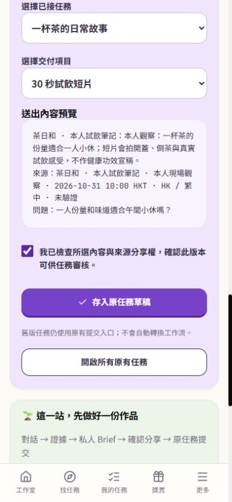
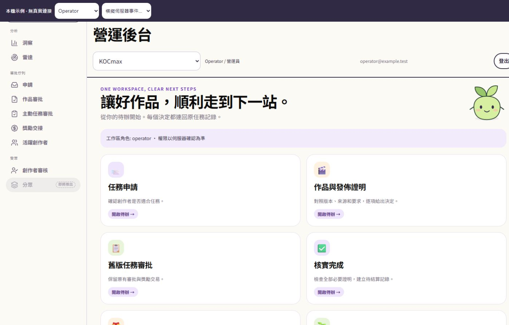

# KOCmax 創作者對話工作室：Stage 1–2 實作與驗證

日期：2026-10-31 HKT。獨立分支 `codex/kocmax-studio-stages-1-2`，基準 `a20b29e2691929f47b26ea9505082bb0882fc404`。

本交付是可供審閱的本機實作。沒有 push、merge、部署、遠端 migration、真實 OAuth、社交平台或 Drive 連接。原本 `C:\Users\laich\Documents\Adfocate` checkout 保留；工作在獨立 worktree。

## 已完成的範圍

| 面向 | 本期實作 | 保留的既有流程 |
|---|---|---|
| 公開入口 | KOCmax 首頁、創作者／品牌 landing、公開任務白名單投影、signup mode 與 safe next | 其他公開頁、法律頁、密碼／magic link／reset、consent、onboarding |
| 共用體驗 | 奶油底、紫／青綠任務卡、插畫吉祥物、等級／XP／積分、桌面側欄與手機底部導航 | 所有既有 route 檔案；未刪除或轉換工作流 |
| 創作者 | 10 張範本、四個討論主題、任務上下文、歷史討論、手動證據、私人 Brief 版本、逐段分享預覽／回執 | 原有 mission workspace、上載、checklist、提交、版本紀錄與發佈證明 |
| 營運 | capability 分流的 reviewer/operator/admin/finance viewer 首頁及共用外殼 | 原審批／退修／proof／completion／settlement 服務與各角色限制 |
| 私隱 | owner/workspace 隔離、來源分享權／撤銷、不可剝除既有段落來源、帳戶匯出與刪除清理 | 原帳戶匿名化、帳本與已提交任務 audit 保留政策 |
| 成長 | 原等級門檻、原帳本積分、核實成果徽章、清楚分開待結算與已入帳 | active mission 的既有 XP 合約；不因聊天、保存或登入而加分 |
| 連接 | 8 個技能卡、未連接與第一期 Instagram＋Drive 的說明 | 沒有 OAuth、token、同步、發信、發佈或日曆寫入 |

完整功能保留依據見 [功能稽核](../../superpowers/specs/2026-10-31-kocmax-function-audit.md)。其餘完整畫面的視覺遷移屬原計畫 Stage 3；真實連接屬 Stage 4。這份報告不把 63 個設計畫面等同於 63 個已重寫的正式頁面。

## 第一條流程與資料邊界

1. 創作者選「拍攝 Brief」任務卡及任務上下文，建立私人 thread。
2. 對話只提供建議，沒有執行任務、發佈或獎勵工具。任務要求使用創作者自身 RLS 可讀的欄位。
3. 手動來源必填問題、平台／出處、觀察時間與內容；固定香港／繁中，全部標示「未驗證」。分享權預設關閉。
4. 另開並編輯私人 Brief；保存不可變版本。來源標記跟隨段落。未授權或已撤銷來源不能轉存。
5. 選擇段落、已接任務及交付項目，確認實際內容與引用，再以原草稿 revision 轉存。
6. SQL 使用既有 `private.save_active_mission_draft`；保存 caption，同時保留 checklist、assets、外部連結與版本衝突檢查。原任務頁仍需獨立提交。
7. 原 review → proof → completion → settlement 繼續作權威流程。批准發佈不等於完成或入帳。徽章只從結算或真實 legacy earn 交易投影，不另改積分／XP。

同一來源依據可多輪追問。來源加入／撤銷或任務規則更改後，新的 context hash 排除舊摘要；晚完成的舊模型回覆也不能成為新上下文。這不刪除創作者自己的歷史記錄。尚未開始的舊要求可取得終止回執，保留輸入並等待新的明確送出，不會自動再生成。

新增 migration 同時補強 `save_assistant_turn`：維持原簽名與 replay 契約，在保存前鎖定 creator，與匿名化序列化，拒絕刪除帳戶後才回來的生成結果。沒有改寫任何歷史 migration。

## 本機啟動

在此 worktree 內執行：

```powershell
npm ci --ignore-scripts
node scripts/studio-dev.mjs
```

預覽：`http://127.0.0.1:8772/`。頁頂工具列可切換示例角色及模擬伺服器事件。資料只在記憶體，重新載入／開發伺服器重啟會重設。範例帳戶、任務、回覆和審核事件都不是真實記錄。外部 fetch 與未實作的 fixture route 會拒絕；這不是可登入真實帳戶的環境。

正式入口仍使用原 `src/main.tsx`。開發專用入口 `src/studio-preview.tsx` 只在 Vite serve 且明確開啟 fixture 時注入；正式 build 已檢查不包含 fixture 標記。

## 開關與 schema

預設全部關閉：`VITE_STUDIO_SHELL`、`VITE_STUDIO_THREADS`、`VITE_PUBLIC_MISSION_PREVIEW`；server 使用 `STUDIO_THREADS` 與 `PUBLIC_MISSION_PREVIEW`。Threads 需要 shell 開啟。沒有修改真實環境變數。

新增 `20261030195424_creator_studio_private_artifacts.sql`：六個私人資料表、owner read RLS、service-only command／recovery RPC、三個徽章／清理 triggers、mission 公開預覽 opt-in，以及上述保存時匿名化保護。所有原任務的 `public_preview_enabled` 預設 false；沒有把現有任務自動公開。

release manifest 已加入 56 項新能力；原 620／598／587 項基線斷言保留，驗證器沒有被放寬。正式啟用前仍須在已獲批准的隔離資料庫執行 migration／Auth／RLS／storage／角色整合驗收。

## 驗證結果

| 命令／層級 | 實際結果 |
|---|---|
| `npm test -- --maxWorkers=2 --minWorkers=1 --testTimeout=15000 --reporter=dot` | 278 files passed、44 skipped；2,504 tests passed、363 skipped；沒有失敗。213 秒 |
| `npm run build` | 通過；含 TypeScript 與正式 Vite bundle。沒有部署 |
| `npm run lint` | 0 errors、4 個原有 hook dependency warnings（PublicationProofReview、activeMission queries、onboarding） |
| `npm run release:manifest:check` | 通過；manifest digest `8c39be176ad61b84ba4261d18569b8c49bee05a60866985bc8daaf804af86c7d` |
| 最後 UI 顯示全部版本的修正 | 對應 StudioWorkspace 4 項測試再次通過，正式 build 再次確認 |
| 既有路由與生產入口 | 沒有刪除任何原有 route；`src/main.tsx` 無內容變更；正式 bundle 無 fixture 標記 |

有意義的新測試包含 owner／workspace 隔離、RLS／RPC 拒絕、來源權限與 lineage、stale draft／brief、回應遺失重放、分享內容選擇、legacy badge 真正寫入順序、刪除帳戶引用清理與晚回覆拒絕、任務規則與多輪上下文、要求復原、財務資料投影、公開任務白名單、UI 確認失效。

基線測試的 Windows 換行影響：兩份既有 D19 checksum 證據以原 Git blob 位元組讀取驗證；沒有改它們的內容或預期 digest，也不納入本次 commit。完整 suite 使用兩個 worker 與 15 秒單測上限，避免既有 manifest CLI 測試在高平行度下超過原 5 秒限時。

## 內建瀏覽器驗證

使用本機 fixture 加上實際 React 頁面。來源與 SQL 測試獨立記錄；瀏覽器 fixture 不等於真實 API／資料庫整合成功。

| 檢查 | 結果與範圍 |
|---|---|
| 320、390、430、768、1024、1440px | 原任務工作區及 Reviewer overview 無水平溢位；修正了 `.sr-only` 上載 input 被共用寬度樣式覆蓋的問題 |
| 390／1440px | 公開首頁、創作者首頁、Brief 與分享、Operator/Admin/Finance viewer 導覽及入口核對 |
| 鍵盤 | 討論 tab 用 ArrowRight 移動後，「證據」同時取得焦點與選中狀態；包含 Home／End 邏輯與 focus-visible 樣式 |
| 任務切片 | 任務卡 → thread → 手動來源 → 私人 v1 → 僅勾選第 2 段 → 確認 → 原草稿 → 原 checklist／提交 |
| 引用核對 | 分享預覽與原任務 caption 一致：來源名稱、出處、`2026-10-31 10:00 HKT`、HK／繁中／未驗證、實際問題；第 1／3 段沒有帶入 |
| 獎勵分段 | 模擬批准發佈與待結算時不加分；模擬 settled 後示例可用積分 200→600、第一份核實成果徽章；XP 保持 800，沒有自創合約 |
| 職員權限 | Reviewer 無 completion／reward 卡；Operator 有核實完成／獎勵交接；Finance viewer 只讀交接；Admin 有管理入口。API 投影另由測試驗證 |
| 減少動畫 | CSS 有 `prefers-reduced-motion` 關閉動畫／transition；沒有改動使用者 OS 設定，未宣稱做過 OS 動態偏好或真機 VoiceOver 驗收 |

後半段 review／proof／completion／settlement 的瀏覽器展示是明確標示的模擬事件，沒有假裝透過真實職員帳戶操作。相關原 SQL／服務回歸與獨立審查覆蓋交易及觸發時序；正式 Auth／多人並發／provider／storage 驗收仍獨立保留。

## 獨立審查

已請獨立 reviewer 檢查整個分支與實際 canonical 函式。修正項目包括：匿名化引用殘留、legacy credit／approval 時序、所選任務及完整 requirements 缺失、多輪對話上下文、context 改變後要求復原、匿名化與晚生成的鎖定順序，以及最後 migration checksum。每項具對應重現或回歸測試。

最終 focused follow-up 沒有剩餘 critical／important findings。Reviewer 以八個獨立記憶體情境覆核實際匿名化與 legacy approval 函式、overlay、來源／規則失效、晚完成結果、request resolver 與 composer 新 UUID。這些是 PGlite 依賴 fixture 和 mocked transport 的證據，不是 production acceptance。

## 證據圖片









## 尚未授權／尚未宣稱完成

- 沒有正式或 staging 部署、沒有遠端 schema 修改、沒有推送或合併分支。
- 沒有實際 AI provider、OAuth、社交平台、Drive、通知傳送或付款驗收。
- integration suite 中需要外部服務的 skipped tests 不是通過；local PGlite 不是 Supabase Auth/storage 的替代證據。
- 沒有把所有既有頁面改造成新設計，也沒有新增正式的排行榜、登入連續天數資料或額外 XP 規則；未知登入天數顯示「未提供」。
- 需要 Stage 3 才逐頁遷移商店、學院、CMS／CRM 等完整功能畫面；Stage 4 才處理已批准的真實 Instagram＋Drive 連接。
