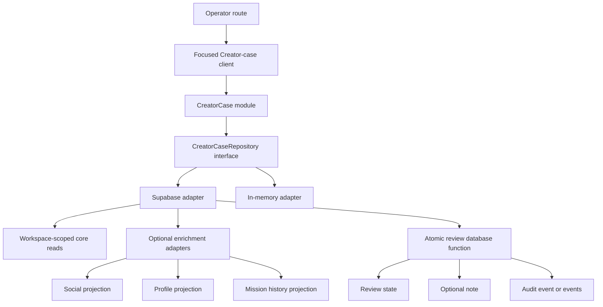

# Creator Case Module Design

**Status:** Design approved for review
**Date:** 2026-08-08
**Scope:** Creator case module for the operator review workflow

## Context

The current Creator operator workflow is distributed across a broad operator CRM repository, a broad admin client module, and a route that translates directly to those functions. The repository currently combines Creator identity, review state, notes, social accounts, profile media, mission history, audit history, and mission shortlist access.

The current detail read loads the core Creator data and all enrichments together. A failure in any one of those reads fails the entire detail operation. The current review command performs an upsert, audit insert, optional note insert, and second audit insert as separate writes. A failure after an earlier write can therefore leave partial state.

The design goal is a deep Creator case module with a narrow repository seam. The module owns the Creator case lifecycle while mission shortlists remain a separate module.

## Goals

- Make Creator identity, review, risk, notes, profile and social projections, audit history, and mission history one coherent deep module.
- Require explicit workspace context for every Creator case operation and fail closed on workspace mismatch.
- Persist review state, an optional note, and audit events atomically through the repository adapter.
- Preserve optional read enrichment without allowing an optional source failure to erase the strict core case.
- Provide an in-memory adapter with the same interface as the Supabase adapter for fast route and policy tests.
- Keep the route focused on HTTP translation and keep Creator-case client calls out of the broad admin client module.
- Preserve mission shortlist locality and behavior outside the Creator case seam.

## Non-goals

- Redesigning mission shortlist policy, storage, or status transitions.
- Combining every operator CRM concern into the Creator case module.
- Seeding production data, running a production migration, or changing production access policy as part of the design work.
- Replacing existing audit event meaning when the same event types can be retained inside the new transaction.
- A visual redesign of the Creator operator page beyond changing its data source and error states.

## Chosen architecture

Use one deep `CreatorCase` module with a `CreatorCaseRepository` seam and two adapters:

1. `SupabaseCreatorCaseRepository` owns workspace-scoped reads and calls one database function for the atomic review command.
2. `InMemoryCreatorCaseRepository` implements the same interface for route, policy, and contract tests.

The module has enough depth to own the case lifecycle, but it does not absorb mission shortlist operations. Social accounts, profile media, and mission history remain source-specific optional adapters behind the Creator case read model. The strict core consists of Creator identity, review state, notes, and audit history.

The route resolves a repository and translates HTTP input/output. It does not issue Creator-case queries or writes directly. The focused client module owns Creator-case request construction and response parsing; unrelated admin domains remain in their existing client module until separately redesigned.

### Proposed module locality

The exact filenames can follow existing repository conventions, but the intended locality is:

```text
server/lib/creatorCase/
  errors.ts
  types.ts
  repository.ts
  supabaseRepository.ts
  inMemoryRepository.ts
  enrichment/
    social.ts
    profileMedia.ts
    missionHistory.ts
src/lib/creatorCase.ts
```

`server/routes/adminOperatorCrm.ts` remains the HTTP route. Its Creator-case handlers resolve the repository, build workspace context, and map domain errors to responses.

## Module interface

The interface is intentionally small. The names below describe the design contract; implementation naming may follow the repository's established conventions.

```ts
type CreatorCaseContext = {
  workspaceId: string;
  actorId: string;
  commandId?: string;
};

type CreatorCaseRepository = {
  listReviewQueue(
    context: CreatorCaseContext,
    filters: CreatorReviewQueueFilters,
  ): Promise<CreatorReviewQueue>;

  getCase(
    context: CreatorCaseContext,
    creatorId: string,
  ): Promise<CreatorCaseReadModel>;

  applyReview(
    context: CreatorCaseContext,
    command: ApplyCreatorReviewCommand,
  ): Promise<CreatorCaseReadModel>;

  appendNote(
    context: CreatorCaseContext,
    command: AppendCreatorNoteCommand,
  ): Promise<CreatorCaseReadModel>;
};
```

`listReviewQueue` is the Creator case collection read. It may expose review queue filters and sorting, but it does not expose mission shortlist mutation.

`getCase` returns a read model with strict core data and explicit enrichment states:

```ts
type Enrichment<T> =
  | { status: 'available'; value: T }
  | { status: 'unavailable'; reason: CreatorCaseEnrichmentFailure };

type CreatorCaseReadModel = {
  creator: CreatorIdentity;
  review: CreatorReviewState;
  notes: CreatorReviewNote[];
  audit: CreatorAuditEvent[];
  social: Enrichment<SocialProjection>;
  profile: Enrichment<ProfileProjection>;
  missionHistory: Enrichment<MissionHistoryProjection>;
};
```

The strict core is still a strict operation. If identity, review, notes, or audit cannot be read, `getCase` fails. Optional adapters may report `unavailable` without hiding the strict core.

## Data flow



Every read and command carries workspace context into the module. The Supabase adapter verifies that the Creator belongs to that workspace before returning or mutating data. The in-memory adapter applies the same check so tests do not bypass the policy.

## Command semantics

### `applyReview`

`applyReview` is the sole review mutation seam. The command includes the Creator identifier, review status, risk level, and an optional note. The context includes workspace and actor identity. A `commandId` is supplied for retry-safe operation; if the same command is replayed, the adapter returns the original committed result without creating duplicate notes or audit events.

Before mutation, the adapter or database function validates:

- the actor has an operator context;
- the Creator exists in the requested workspace;
- the review status and risk level are valid;
- any flagged-review note requirement is satisfied;
- the command identifier is valid and has not already completed with a conflicting payload.

The Supabase adapter invokes one private database function. That function performs the review upsert, optional note insert, and required audit insert(s) in one transaction. Existing audit event meaning should be preserved; the important change is that all events are committed or rolled back with the review and note.

The function returns the committed result needed by the route. The adapter then rehydrates or returns the committed Creator case without issuing an unrelated mutation from the route.

### `appendNote`

The note-only route remains available for an operator who wants to add context without changing review state. It is a separate repository command, but it uses the same transaction rule: note and its audit event commit together or neither commits.

## Error semantics

Domain errors remain explicit and stable at the repository seam. The existing error vocabulary can be retained and expanded only where the deep module needs a more precise contract.

| Domain condition | Repository behavior | Route response |
| --- | --- | --- |
| Missing Creator | No writes | Non-disclosing 404 |
| Workspace mismatch | No writes; do not reveal cross-workspace existence | Non-disclosing 404 |
| Invalid review or risk input | No writes | 422 |
| Flagged review without required note | No writes | 422 |
| Replayed `commandId` with same payload | Return original committed result | 200/201 according to existing route contract |
| Replayed `commandId` with different payload | No writes | 409 |
| Unauthenticated or missing operator context | Repository is not invoked | 401/403 |
| Database or transaction failure | Transaction rolls back | 500 with correlation ID |
| Optional enrichment failure | Core result remains available | 200 with `unavailable` enrichment state |

The route must not expose database details, SQL errors, or cross-workspace existence. The adapter translates database-function errors into the domain error vocabulary before the route maps them to HTTP.

## Workspace authority

Workspace context is mandatory for every Creator case method, including reads. The module must not infer a workspace from the Creator identifier or from a client-provided filter alone.

The route derives workspace and actor identity from the authenticated operator context. A break-glass path, if retained, must still resolve to an explicit workspace context and must remain subject to the same repository checks. No Creator case method accepts an unscoped direct database-client call as its public contract.

## Read enrichment semantics

The strict core and optional enrichment have different failure semantics:

- Creator identity, review, notes, and audit are required for a valid Creator case.
- Social projection, profile media, and mission history are optional adapters.
- An optional adapter failure is represented as `unavailable` with a safe reason code, not as a fabricated empty value.
- The route and client render the core case and show a source-specific unavailable state for optional data.
- The existing profile media module remains the owner of profile-media source access; Creator case composes its projection rather than duplicating that source logic.

This preserves locality while allowing the operator to review a Creator when one enrichment source is degraded.

## Testing strategy

### Repository contract tests

Create one contract suite that runs against both repository adapters. It must cover:

- workspace-scoped queue and detail reads;
- review and risk updates;
- optional note in the review command;
- note-only append;
- audit history;
- missing Creator and workspace mismatch;
- flagged-review note requirements;
- same-command replay and conflicting replay;
- optional enrichment available and unavailable states.

### Database-function integration tests

Use an isolated test database or approved test database configuration to prove:

- review, note, and audit commit together;
- a failure at each logical write point rolls back all changes;
- the transaction enforces workspace ownership;
- the idempotency record prevents duplicate audit and note rows.

These tests are the evidence for database atomicity. The in-memory adapter can mirror behavior but cannot prove the database transaction itself.

### Route and client tests

- Inject a repository adapter into route tests and verify HTTP translation without direct database access.
- Assert non-disclosing responses for workspace mismatch.
- Assert 422 responses for validation and flagged-review failures.
- Assert 500 responses contain a correlation ID but no database details.
- Move Creator-case request construction into the focused client module and test its query, mutation, and error parsing behavior.

### Architecture regression test

Add a focused check that Creator-case route mutations resolve through the repository seam and that the route no longer imports direct Creator-case write functions. This prevents the module from becoming shallow again after the extraction.

Existing mission-shortlist tests remain in their current module and continue to verify shortlist policy, idempotent upsert behavior, flagged invite restrictions, and workspace matching.

## Migration sequence

The implementation plan should follow this order:

1. Extract Creator-case types, errors, and the repository interface without changing route behavior.
2. Add the in-memory adapter and repository contract tests.
3. Implement the Supabase adapter and the atomic database function/migration behind the interface.
4. Add the optional enrichment adapters and explicit unavailable read states.
5. Inject the repository into `adminOperatorCrm` and preserve existing route response shapes where practical.
6. Move Creator-case client calls out of `src/lib/admin.ts` and update the Creator detail route.
7. Add database-function integration coverage and the architecture regression check.
8. Remove obsolete direct Creator-case repository imports after focused route and client tests pass.

Production migration, seeding, and deployment remain separate approval gates.

## Rejected alternatives

### Shallow extraction of the existing repository

Rejected because it would move files without increasing depth. The current failure semantics and separate review writes would remain, so the module would have little leverage.

### Direct database function calls from the route

Rejected because it would couple HTTP translation to persistence details and would not provide the in-memory adapter seam needed for fast policy and route tests.

### Separate review, social, profile, and mission-history modules with no Creator case owner

Rejected because the operator workflow is a case review workflow. Without a deep Creator case module, the route and client would continue orchestrating several shallow modules and would retain poor locality.

### Making all enrichments strict

Rejected because a degraded social, profile, or mission-history source should not prevent review of the strict Creator case.

## Acceptance criteria

The design is implemented successfully when:

- Creator case reads and review mutations enter through `CreatorCaseRepository`.
- Every operation is workspace-scoped.
- `applyReview` atomically persists review state, optional note, and audit event(s) through the Supabase adapter.
- A failed command leaves no partial review, note, or audit state.
- Replaying a successful `commandId` does not duplicate side effects.
- Optional enrichment failures are explicit and do not erase the strict core.
- Creator-case client calls are focused and the route is HTTP translation only.
- Mission shortlist behavior remains separate and regression-tested.
- Contract, database-function, route, client, and architecture tests provide the evidence above.

No application code has been changed by this design document.
