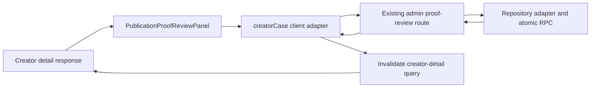

# Creator Case Publication-Proof Review Panel Design

**Status:** Design drafted for user review
**Date:** 2026-08-10
**Scope:** Operator-facing publication-proof review inside the Creator Case deep module

## Context

The Creator Case backend now exposes workspace-scoped publication-proof projections and an atomic operator review command. The operator detail route already owns the Creator Case read model and the generic Creator review action, but the client contract does not yet expose publication proofs and the route has no proof-specific review surface.

The next slice adds a focused right-rail panel. Proof decisions remain separate from creator-level approval, risk, notes, and shortlist state while using the repository-backed command already established by the server.

## Goals

- Show every publication proof attached to the Creator Case, including the current attempt and immutable history.
- Make only the current `submitted` attempt actionable.
- Support `verified` and `changes_requested` decisions through the existing admin route.
- Require non-empty operator feedback for `changes_requested`.
- Preserve retry-safe command IDs and safe API error handling.
- Invalidate the Creator detail query after a successful decision.
- Keep the panel independently testable and keep the route orchestration thin.

## Non-goals

- Changing the Creator Case server repository, RPC, migration, or error vocabulary.
- Reusing the Creator Studio authoring/evidence-upload component for operator decisions.
- Changing generic Creator review status, risk, notes, shortlist behavior, rewards, or payouts.
- Applying a database migration, seeding production data, or performing a deployment.
- Adding metadata inspection, evidence upload, or provider-backed verification to the operator panel.

## Chosen architecture

Add a dedicated client component and a narrow client adapter:

```text
src/lib/creatorCase.ts
  CreatorCasePublicationProofAttempt
  CreatorCasePublicationProof
  postCreatorPublicationProofReview(...)

src/components/operator/PublicationProofReviewPanel.tsx
  read-only and actionable proof cards
  per-attempt command state and validation

src/routes/operator.creators.$creatorId.tsx
  render panel in the existing right rail
  invalidate the existing creator-detail query after success
```

The client adapter calls:

```text
POST /api/admin/creators/:creatorId/publication-proof/review?workspace=:workspaceId
```

with:

```json
{
  "command_id": "uuid",
  "submission_id": "uuid",
  "work_item_id": "uuid",
  "attempt_id": "uuid",
  "decision": "verified | changes_requested",
  "message": "optional string"
}
```

The response is `{ publicationProof: CreatorCasePublicationProof | null }`. The adapter owns path construction, snake_case serialization, command ID creation, and typed response boundaries. The component does not issue raw fetch calls.

## Interaction model

The panel renders one card per proof projection:

| Current state | Display | Actions |
| --- | --- | --- |
| No proof | Empty state explaining that no proof is linked | None |
| `draft` | URL/platform and “awaiting creator submission” state | None |
| `submitted` | URL, platform, sequence, submitted time | Verify; Request changes |
| `verified` | Verified badge, decision time, operator message if present | None |
| `changes_requested` with a correction draft | Prior decision and feedback, current draft state | None; awaiting creator resubmission |

Selecting Request changes reveals a feedback textarea. The submit action is disabled until the trimmed message is non-empty. Verify does not require a message. Each attempt owns its pending state and command ID so a retry cannot accidentally reuse another proof’s payload.

The panel does not optimistically rewrite the proof projection. On success it invalidates `["admin-creator-detail", creatorId, workspace]`; the server response is then re-read as the source of truth. While pending, the current attempt’s controls are disabled and the action label communicates progress.

## Data flow



The detail response remains the read source. The panel only chooses a decision and supplies the complete proof lineage returned by that response. The server remains authoritative for workspace, creator, submission, workflow, work-item, and attempt lineage.

## Error handling

`adminFetch` already converts non-2xx responses into `AdminRequestError`. The panel maps stable codes to safe inline messages:

- `proof_message_required`: feedback is required before requesting changes.
- `proof_attempt_not_submitted`: the attempt is no longer actionable; reload the case.
- `proof_attempt_not_found` or `proof_lineage_mismatch`: the proof is no longer available in this case; reload.
- `command_conflict`: a prior command used the same ID with different data; generate a fresh retry ID.
- `db_error` or unknown failure: show a generic retry message with no database details.

Authentication errors continue through the existing operator auth context. No error displays raw SQL, provider output, or cross-workspace existence.

## Testing and acceptance

Add focused client tests for:

- exact adapter path, payload, command ID, and response mapping;
- empty, draft, submitted, verified, and correction-history rendering;
- verify success and detail-query invalidation;
- required feedback validation for Request changes;
- pending control disabling and retry-safe command IDs;
- safe rendering for each known API error code.

Add or extend the operator detail route test to prove `publicationProofs` reach the panel and that a successful panel decision invalidates the existing detail query. Run targeted ESLint and Vitest checks for the changed client files and existing Creator Case regressions.

The slice is accepted when proof review is visibly separate from generic Creator review, only submitted attempts can be acted on, all commands use the existing repository-backed route, and no server or production state outside this client slice changes.

## Deferred decisions

- Whether operators eventually need evidence-image previews or metadata refresh controls belongs to a separate operator evidence-review slice.
- Whether proof cards should later support filtering belongs to a separate case-navigation design.
